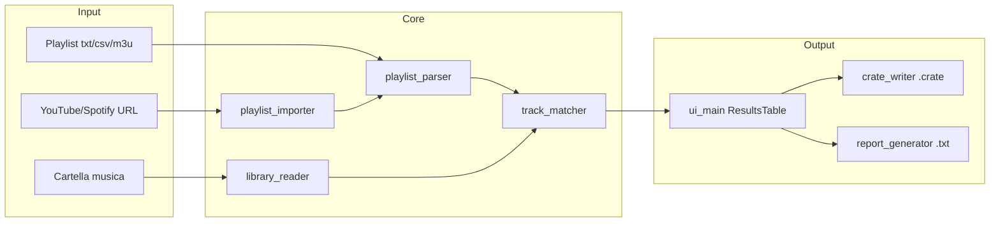

# Architettura tecnica — Serato Playlist Automation v4.2

Documento per sviluppatori e AI che estendono il codebase.

---

## Diagramma flusso dati



---

## Moduli e responsabilità

| Modulo | Classe/i principali | Ruolo |
|--------|---------------------|-------|
| `main.py` | `main()` | Entry, check dipendenze |
| `config.py` | `load_config`, `save_config` | JSON persistente |
| `playlist_parser.py` | `PlaylistParser`, `PlaylistTrack` | Normalizza righe playlist |
| `playlist_importer.py` | `import_playlist_from_url` | Scraping YouTube/Spotify |
| `library_reader.py` | `LibraryReader`, `LibraryTrack` | Scan ricorsivo + mutagen |
| `track_matcher.py` | `TrackMatcher`, `MatchResult` | Matching multi-pass + scoring |
| `crate_writer.py` | `CrateWriter` | Binary Serato crate TLV |
| `report_generator.py` | `ReportGenerator` | TXT mancanti / summary |
| `log_handler.py` | `setup_logging` | File + console log |
| `ui_main.py` | `MainWindow`, `ResultsTable`, workers Qt | Tutta l'UI |

---

## Threading (Qt)

| Worker | Trigger | Segnali |
|--------|---------|---------|
| `LibraryScanWorker` | Scansiona Libreria | progress, finished, error |
| `MatchWorker` | Confronta con Libreria | progress, finished |
| `ImportWorker` | Import URL | progress, finished, error |

`MainWindow.closeEvent` attende terminazione worker attivi.

---

## ui_main.py — classi UI rilevanti

```
ClickableSlider(QSlider)       # click groove → seek
PlayerCellWidget(QWidget)      # play/pause + slider per riga
RowHighlightOverlay(QWidget)     # bordo riga sopra cell widget
ResultsTable(QTableWidget)     # tabella risultati + lock/found/player
MainWindow(QMainWindow)          # controller app + QMediaPlayer condiviso
FormatGuideDialog                # prompt IA pulizia playlist
ImportUrlDialog                  # import YouTube/Spotify
```

---

## track_matcher — dati

```python
@dataclass
class MatchResult:
    playlist_track: PlaylistTrack
    candidates: List[CandidateMatch]
    selected_index: int = 0

    @property
    def is_effectively_matched(self) -> bool:
        return self.is_matched and self.score > 0
```

Lock paths (priorità):
1. `_check_composer_lock()` — `[lock]` in LibraryTrack.composer
2. `_check_title_lock()` — dict title_locks filepath

---

## Persistenza

| File | Contenuto |
|------|-----------|
| `config.json` | Preferenze utente |
| `title_locks.json` | Map titolo normalizzato → filepath |
| `library_cache_<md5>.pkl` | Snapshot LibraryTrack[] + timestamp |
| Metadati audio | `[lock]` in composer/TCOM/©wrt |

---

## Crate Serato — vincoli

- Output: `{Subcrates}/{nome}.crate`
- Stesso drive letter della musica (validazione in `validate_crate_drive`)
- Path relativi senza drive (`Users/.../track.mp3`)
- Encoding binario TLV documentato in `crate_writer.py`

---

## Estensioni consigliate

| Feature | Punto di intervento naturale |
|---------|------------------------------|
| Nuovo formato playlist | `playlist_parser.py` |
| Nuova sorgente import | `playlist_importer.py` |
| Regola scoring | `track_matcher.py` post-rules |
| Nuova colonna tabella | `ui_main.py` COL_* + `_populate_row` |
| Export verso altro DJ sw | nuovo modulo + bottone in toolbar |

---

## Dipendenze

```
PySide6>=6.6.0
rapidfuzz>=3.0.0
mutagen>=1.47.0
```

Opzionale dev: `python-docx` (solo generazione docs, non runtime app).

---

## Versioning

Storico completo nei commenti header di `ui_main.py` (v2.5 → v4.2). Ogni release bumpa almeno:
- `ui_main.py` header + window title + log avvio
- `main.py` banner console
